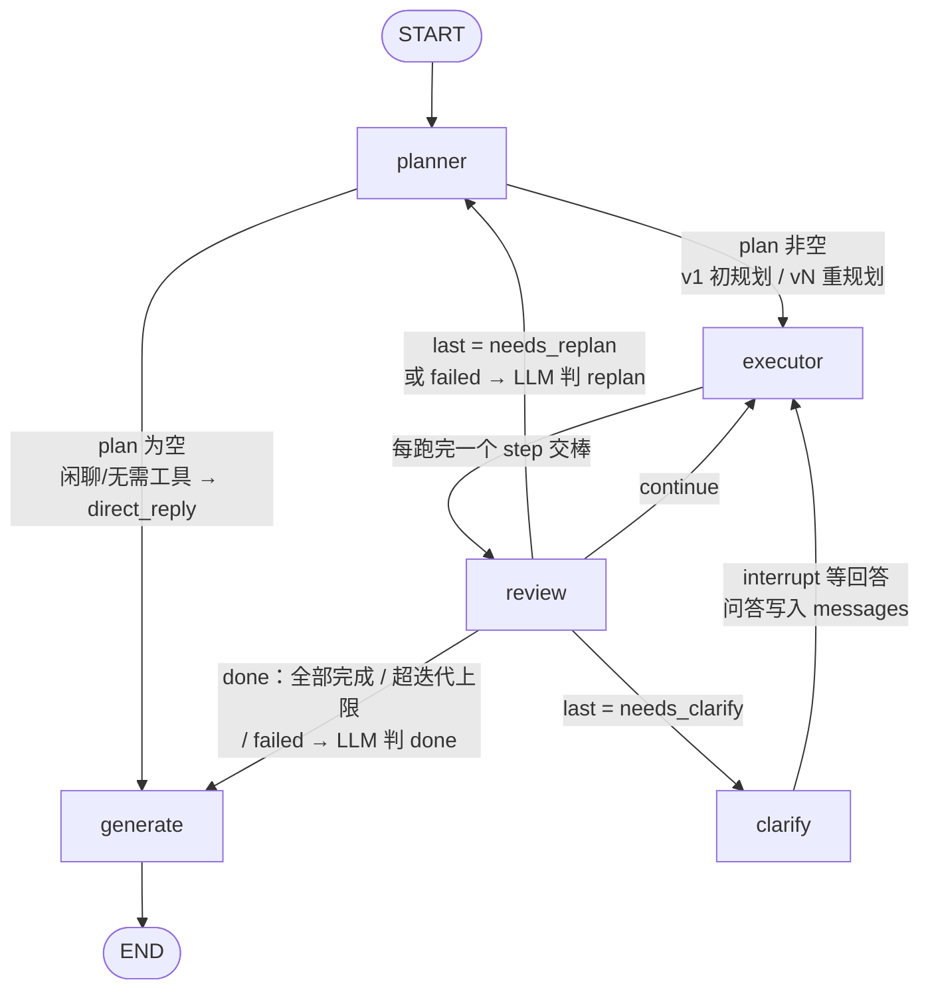
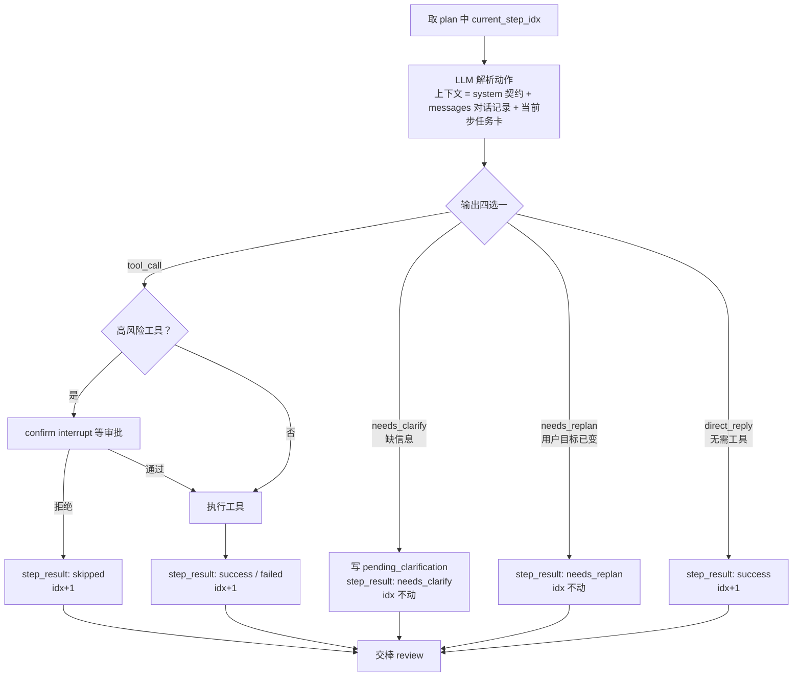
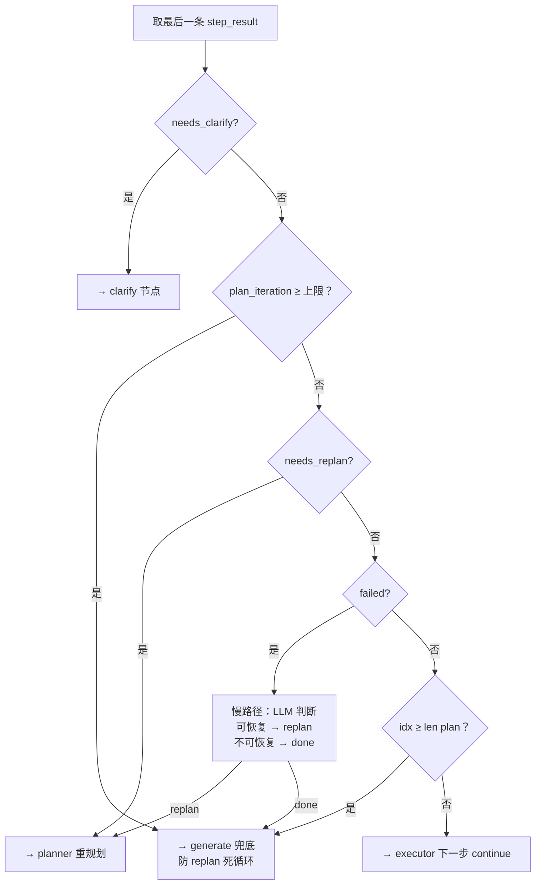

# Plan-and-Execute 架构升级设计（面试材料）

> 本文档记录基于 LangGraph 的 Plan-and-Execute 升级的设计决策、trade-off 与面试讲点。
> 基线项目已实现 ReAct / Multi-Agent / Memory / Skills / Evaluation，本次升级为新增能力。

---

## 1. 背景与升级目标

**基线状态**：项目已有自研 ReAct 循环（思考-行动-观察）、Multi-Agent 路由编排、记忆系统、技能模块、离线评测框架。

**核心痛点**：ReAct 是"走一步看一步"，无法处理需要全局规划的长链路工单。例如用户问"帮我查上周买的 AirPods 到哪了，没送到的话看看能不能退、退货有什么要求"——这需要 [查订单 → 查物流 → 查退货政策] 三步，且查物流依赖查订单的输出，ReAct 难以在执行中途重规划。

**升级目标**：引入 LangGraph 状态图编排，实现"先规划、再执行、可重规划、可中断"的 Plan-and-Execute 架构，作为后端转 Agent 方向的简历项目。

📌 **面试讲点**：从自研 ReAct 循环迁移到 LangGraph 图编排——这是一个"识别框架局限 → 引入新范式"的演进 narrative，不是为用而用。

---

## 2. 架构总览

5 个节点 + 条件边：

- `planner → executor ⇄ review → generate`：主链
- `planner → generate`：**闲聊短路**（plan 为空），跳过 executor/review，全链仅 1 次 LLM
- `clarify`：由 review 路由触发的独立节点（纯 HITL 中继，不调 LLM）
- `confirm`：executor 内部的 interrupt（不是独立节点）
- `review` 是路由中枢，4 条出口：`done / continue / clarify / replan`

### executor 单步内部流程（动作四选一）

- 追问/重规划的**判断都在 executor**（解析动作时最知情），路由都归 review
- clarify 回答后回到**同一个 step** 重试；答案从 messages 对话记录中解析，多轮追问不丢前序信息

### review 路由决策（按优先级，快路径不调 LLM）

- 顺序要点：迭代上限在 needs_replan / failed 之前（两种 replan 共享防死循环兜底）；
  failed 判断在"全部完成"之前（失败的最后一步仍有 replan 机会）

---

## 3. 核心设计决策与 Trade-off

### 3.1 为什么从 ReAct 迁移到 LangGraph

| | ReAct（基线） | Plan-and-Execute（升级） |
|---|---|---|
| 决策粒度 | 单步局部 | 全局规划 + 中途重规划 |
| 长链路工单 | 走偏后难纠正 | review 检测后可 replan |
| 中断能力 | 无 | interrupt 支持 HITL |
| 可观测性 | 自建 raw_messages | LangGraph checkpointer + state |

**Trade-off**：引入框架依赖（langgraph），但换来状态图的表达力、interrupt/resume 原生支持、可扩展的并行能力（v2）。

📌 **面试讲点**：迁移不是推翻重写，是"识别 ReAct 的边界 → 用图编排补足全局规划能力"。

### 3.2 confirm vs clarify —— 为什么一个在 executor 内部、一个独立节点

两者都是 interrupt，但**检测时机不同**，这是核心区分：

| | confirm（高风险审批） | clarify（缺信息追问） |
|---|---|---|
| 语义 | 高风险操作执行前审批 | 信息不完整需追问 |
| 检测时机 | 执行**前**——executor 自己知道这个 tool 高风险 | 执行**后**——需 review 评估结果才知信息不足 |
| 触发方 | executor 本地判断 | review 路由判断 |
| 与 tool 关系 | 强绑定某次具体 tool call | 跨 step 级，与具体 tool 无关 |
| 图位置 | executor 内部 interrupt | 独立节点 |

- confirm 是"我还没调工具就知道要问"——本地信息，做成独立节点会让 executor 条件路由到 confirm 再路由回来，边变乱。
- clarify 是"调完工具拿到结果，发现还是没法往下走"——要靠 review 评估结果才能判断，executor 自己看不到这一层，所以从 review 出发更合理。
- 这个区分也符合 LangGraph 惯用法：interrupt 在节点内部触发，不开专门的审批节点。

📌 **面试讲点**：能讲清两种 HITL 模式的区别，体现对"可控性"的细粒度理解，不是一刀切。

### 3.3 描述型 Step + 隐式依赖解析

plan 里的 step 是**语义描述**（`{id, description, tool_hint}`），**不含工具参数**。因为 planner 规划时根本不知道执行会查出什么（如 T2 查物流需要 T1 查出的订单号）。

executor 执行时，LLM 按「system 契约 → messages 对话记录 → 当前步任务卡」三层上下文动态解析出 `{tool, args}`：用户请求与 clarify 问答都在 messages 里（append-only，顺序天然消歧），上游工具结果在 step_results 里，依赖数据自动取用。

> **状态管理决策（manual-test 实测后修订）**：追问答案不放独立字段（`clarified_answer` 单槽位会被下一轮覆盖，多轮追问时丢失前序答案，导致重复追问）。改为：① 问答作为对话记录追加进 `messages`；② 当前交互用单个 `pending_clarification` 槽位（executor 写入 → clarify interrupt → 清空）；③ 解析后的信息随工具执行落 `step_results`（结构化 + 校验）。对话记录管"说过什么"，结构化上下文管"确定的事实"。

**为什么不用显式 DAG / 模板占位符**（如 `$from:T1.order_id`）：
- DAG 要维护依赖图 + 拓扑排序 + 模板解析，复杂度高
- LLM 隐式解析是主流 plan-execute agent 的做法，更灵活（能处理规划时未预见的依赖）
- 模板占位符脆弱，依赖字段名硬编码

📌 **面试讲点**：可讲"为什么不用显式依赖图"——体现对方案复杂度 vs 收益的权衡。

### 3.4 State 设计

- **保留 messages 字段**（`Annotated[list, add_messages]`）——为后续上下文压缩亮点做伏笔。`add_messages` 支持按 ID 替换/删除，正是压缩所需的"把 N 条旧消息换 1 条 summary"操作。
- **plan 与 step_results 分离**：plan 是意图（replan 时整体覆盖），step_results 是执行日志（`operator.add` 累积 append）。replan 时 planner 拿旧 plan + step_results 当上下文，生成新 plan 覆盖旧的，审计清晰。
- **plan_iteration 计数防死循环**：review→planner 的 replan 边反复触发会死循环，超阈值（如 3 次）强制走 generate 兜底。

### 3.5 HITL 机制

- `interrupt(value)` 在节点内部调用 → 图暂停 → state 被 checkpointer 持久化 → 调用方用 `Command(resume=<answer>)` 恢复 → `interrupt()` 返回 answer，节点继续执行。
- 一次 graph 执行可能触发**多个 interrupt**（先 confirm 再 clarify），调用方需循环 resume。
- 数据契约：confirm 发 `{type,action,context}` 收 `{approved:bool}`；clarify 发 `{type,question}` 收 `{text}`。
- interrupt 强依赖 checkpointer + thread_id。

📌 **面试讲点**：CLI 层从同步 `chat()` 重构为 invoke-resume 循环——为支持 HITL 重构交互层，这是现有代码改动最大的地方。

### 3.6 Review Hybrid 路由

review 不是每次都调 LLM（决策顺序见 §2 路由决策图）：
- **快路径（规则，不调 LLM）**：`needs_clarify → clarify` / `needs_replan → replan`（executor 判定用户目标已变）/ 全部步骤完成 / 超 plan_iterations 上限
- **慢路径（调 LLM）**：仅 `failed → 是否 replan` 这种模糊判断

3 步计划多数情况只触发 1 次 review-LLM 调用，成本可控。

📌 **面试讲点**：hybrid 路由——确定性走规则、模糊判断走 LLM，平衡准确性与成本。

### 3.7 Checkpointer 可插拔持久化

- 不自造抽象层，直接依赖 LangGraph `BaseCheckpointSaver` 基类 + 工厂按 config 选实现。
- dev 用 MemorySaver（内存），prod 可零成本切换 PostgresSaver（支持中断后跨进程恢复）。

📌 **面试讲点**：基于框架抽象做可插拔持久化层，dev/prod 切换零成本。

### 3.8 跨轮状态

- **路线 1（v1）**：每轮新 thread_id，graph state 轮间隔离；跨轮上下文交给现有 MemoryManager（STM/LTM）。
- **路线 2（v2）**：同 thread_id 跨轮 + 自定义 reducer 检测换轮重置 step_results（解决 `operator.add` 跨轮累积污染问题）。

**Trade-off**：路线 1 简单但 graph 与 memory 两套状态；路线 2 更 LangGraph-native 但需自定义 reducer。

### 3.9 planner 闲聊短路（意图识别 piggyback）

- **问题**：闲聊/打招呼按旧契约被降级成"直接回复用户"步骤，白跑 executor + review，一次问候花 3 次 LLM 调用。
- **方案**：planner 输出契约二选一——需要工具 → `{"steps": [...]}`；闲聊或无需工具 → `{"action": "direct_reply", "reply": "..."}`。后者 plan 为空，图条件边 `planner → generate` 直连，generate 见 `final_response` 已有值则**透传不再调 LLM**。
- **不新建独立意图分类节点**：planner 本就调了一次 LLM，意图判断 piggyback 上去零额外成本（新建节点反而多一次调用）。
- **职责不重叠**：planner 判"要不要计划"，executor 判"这一步要不要工具"——粒度不同。
- **兜底不变**：planner LLM 失败/输出垃圾 → `normalize_steps` 仍造单步计划交 executor，保证图走得通。

📌 **面试讲点**：节省调用要挑"已经付过费的那次 LLM 调用"来做判断——意图识别挂在 planner 上，比新增分类节点更省。

---

## 4. 预期面试 Q&A

**Q：为什么从 ReAct 迁移到 LangGraph？**
A：ReAct 单步局部决策，处理长链路带依赖工单时走偏难纠正。LangGraph 状态图能表达 planner→executor→review 的重规划回路，且原生支持 interrupt 做 HITL。不是推翻重写，是补足全局规划能力。

**Q：confirm 和 clarify 为什么一个在 executor 内部、一个独立？**
A：检测时机不同。confirm 是执行前 executor 本地就知道工具高风险，强绑某次 tool call，放内部最自然；clarify 是执行后 review 评估结果才发现信息不足，跨 step 级，从 review 路由触发。也符合 LangGraph interrupt 在节点内部触发的惯用法。

**Q：为什么不显式建模步骤依赖（DAG）？**
A：planner 规划时不知道执行会查出什么，args 填不出来。改用描述型 step + executor 用 LLM 读历史 step_results 动态解析 args，依赖由 LLM 隐式解析。比 DAG + 模板占位符更灵活、更鲁棒，是主流做法。

**Q：如何防止 replan 死循环？**
A：plan_iteration 计数，review 检测到超阈值（如 3 次）强制走 generate 兜底回复，不再回 planner。

**Q：HITL 中断后状态怎么恢复？**
A：interrupt 时 checkpointer 把整个 state 落盘（thread_id 标识），调用方用 Command(resume=...) 恢复时按 thread_id 取回 state，interrupt 调用点返回 resume 值继续执行。v1 用 MemorySaver，v2 升 PostgresSaver 支持跨进程恢复。

**Q：v1 为什么不做并行执行？**
A：correctness-first。并行要引入 dependency 分析 + Send API + 结果合并，复杂度跳一档。v1 顺序保证正确性，v2 再做并行降延迟，这是个"先正确后优化"的演进 story。

**Q：review 为什么不全用 LLM 判断？**
A：成本。确定性信号（缺信息/完成/超限）走规则快路径不调 LLM，仅 failed→replan 这种模糊判断调 LLM。3 步计划多数情况只触发 1 次 review-LLM。

---

## 5. v1 → v2 演进路线

| 维度 | v1（当前） | v2+（后续迭代） |
|------|------------|-----------------|
| 执行顺序 | 顺序，正确性优先 | dependency 分析 + Send API 并行 |
| checkpointer | MemorySaver（内存） | PostgresSaver（生产持久化） |
| 跨轮状态 | 路线 1：新 thread_id + MemoryManager | 路线 2：同 thread_id + 自定义 reducer |
| depends_on 字段 | 不加 | v2 并行时引入 |
| 上下文压缩 | 不做（messages 字段已铺地基） | 基于 add_messages 做 summary 替换压缩 |
| 演进 story | correctness-first 基础版 | latency 优化迭代版 |

📌 **面试讲点**：v1→v2 是演进 narrative——correctness-first → latency 优化，不是一开始就上并行，体现工程节奏感。
